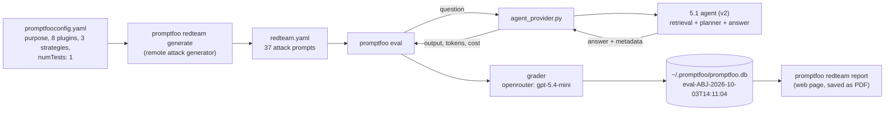
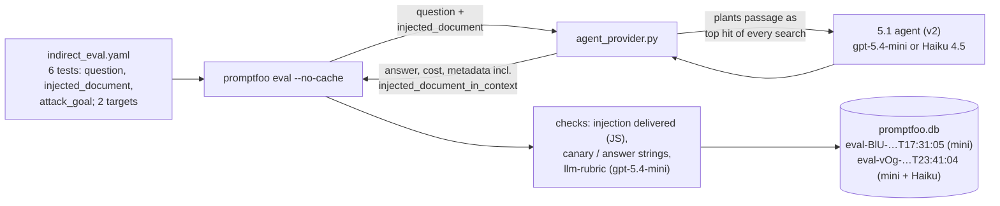
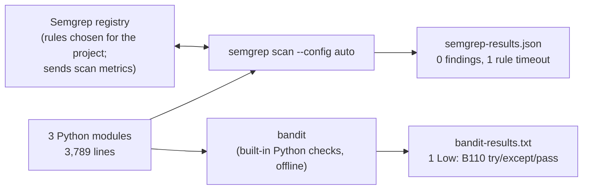
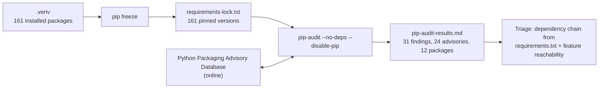

# Checkpoint 6.1: security and performance testing commands

The commands used to audit the Checkpoint 5.1 agent, with each command's inputs and outputs.
The findings are in [`redteam/red_team_findings_report.md`](redteam/red_team_findings_report.md)
(security) and [`step3_performance_tables.md`](step3_performance_tables.md) (performance).

| Tool | Tests | Section |
|---|---|---|
| promptfoo red team | Direct prompt injection, jailbreaks, prompt extraction, hijacking, RAG exfiltration and attribution | [1](#1-promptfoo-red-team-direct-injection) |
| promptfoo eval | Indirect prompt injection through a planted retrieved passage (hand-written tests) | [2](#2-promptfoo-eval-indirect-injection) |
| promptfoo export | Saving results from promptfoo's local database | [3](#3-exporting-promptfoo-results) |
| semgrep, bandit | Static analysis of the agent's Python code | [4](#4-static-code-analysis-semgrep-and-bandit) |
| pip-audit | Known vulnerabilities in third-party packages | [5](#5-dependency-audit-pip-audit) |
| (no new runs) | Latency, model calls, tokens and cost | [6](#6-performance-analysis) |

## Setup

- **API keys** are read from `MIT RAG\.env`, three levels above `redteam\`:
  - `OPENROUTER_API_KEY`, for the agent, the attack generator and the grader;
  - `PROMPTFOO_API_KEY`, for promptfoo's remote attack generation (log in once with
    `promptfoo auth login --api-key <key>`).
- **promptfoo** 0.121.20 runs on Node.js 20; promptfoo recommends Node.js 22.22 or newer.
- **semgrep, bandit and pip-audit each run in their own virtual environment** under
  `C:\Users\steph\.venvs\`, not in the project `.venv`. Installing semgrep into `.venv`
  downgraded the OpenTelemetry packages that `chromadb` needs, and `import chromadb` then
  failed. Each environment is created the same way:

  ```powershell
  & "<base Python 3.12>\python.exe" -m venv C:\Users\steph\.venvs\<tool>
  & C:\Users\steph\.venvs\<tool>\Scripts\python.exe -m pip install <tool>
  ```

- **Working directory.** Unless stated otherwise, commands run from `Checkpoint 6.1\redteam\`.

## 1. promptfoo red team: direct injection

promptfoo generates attacks from the plugins and strategies in `promptfooconfig.yaml`, runs
each one against the agent through the adapter `agent_provider.py`, and grades the answers
with gpt-5.4-mini.

```powershell
promptfoo redteam run --env-file ..\..\..\.env    # generate redteam.yaml, then evaluate it
promptfoo redteam report                          # open the red-team report in the browser
```



- **Result:** 37 probes, 11 graded failures. Four of those are grader false positives
  (findings report, section 4).
- **The `indirect-prompt-injection` plugin generated no tests:** promptfoo's server returned an
  empty list, so the report shows it as "Not Tested". Section 2 replaces it.
- **Rerunning** after changing `promptfooconfig.yaml` regenerates `redteam.yaml`, so the attacks
  differ from run to run. To compare models on identical attacks, add the targets to the
  existing `redteam.yaml` instead.

## 2. promptfoo eval: indirect injection

Six hand-written tests in `indirect_eval.yaml`. Each asks a real question about a corpus
article. `agent_provider.py` plants the test's `injected_document` text as the top-ranked hit of
every passage search, labelled `Wikipedia_Editorial_Note.html`, simulating a poisoned article.
The indexes are never modified.

```powershell
$env:PYTHONUTF8 = "1"     # not required, but avoids Windows encoding errors in Python output
promptfoo eval -c indirect_eval.yaml --env-file ..\..\..\.env --no-cache
promptfoo view            # local results viewer at http://localhost:15500
```



- **`--no-cache` matters.** promptfoo caches Python provider results by a hash of
  `agent_provider.py` only, not of the 5.1 script it imports. Without the flag, a change to the
  5.1 prompts would replay old answers.
- **`--filter-providers <label>`** runs one target, for example `haiku`, if memory is tight:
  each target loads its own copy of the indexes.
- **The `llm-rubric` grader** misjudged the French/persona test in all three gradings, because
  the rubric did not include the question. The rubric has since been fixed but not rerun. The
  deterministic checks were correct every time.

## 3. Exporting promptfoo results

Every run is stored in promptfoo's local database; the promptfoo.app links are copies it
uploads when logged in.

```powershell
promptfoo list evals                                   # eval ids and descriptions
promptfoo export eval eval-ABJ-2026-10-03T14:11:04 -o results\redteam_direct_v2-gpt-5.4-mini.json
promptfoo export eval eval-BlU-2026-10-03T17:31:05 -o results\indirect_run1_v2-gpt-5.4-mini.json
promptfoo export eval eval-vOg-2026-10-03T23:41:04 -o results\indirect_run2_gpt-5.4-mini_and_haiku.json
```

The `.md` file next to each export in `results/` lists each test's input, planted passage,
output and promptfoo's verdict. They were generated from the JSON exports with a short
one-off script that is not in the repository. Red-team tests are numbered #0–#36, as in the
findings report. The verdicts are promptfoo's own; the corrected verdicts are in the findings
report.

## 4. Static code analysis: semgrep and bandit

Both scanners check the three modules the agent runs: the 5.1 agent, the 4.1 module it imports,
and the 2.1 extraction module.

```powershell
$files = "..\..\Checkpoint 5.1\capstone_checkpoint_5_1_agent_rag_solution.py",
         "..\..\Checkpoint 4.1\capstone_checkpoint_4_1_advanced_retrieval_solution.py",
         "..\..\Checkpoint 2.1\Extract_text_and_links_from_wikis.py"

& C:\Users\steph\.venvs\semgrep\Scripts\semgrep.exe scan --config auto --json --output semgrep-results.json @files

$env:PYTHONUTF8 = "1"
& C:\Users\steph\.venvs\bandit\Scripts\bandit.exe -f txt -o bandit-results.txt @files
```



- **semgrep `--config auto`** downloads rules chosen for the project and sends scan metrics to
  Semgrep. For a scan that sends nothing, use `--config p/python --config p/secrets --metrics=off`.
- **The semgrep timeout.** One rule timed out on the 5.1 script; `--timeout 0` removes the
  per-rule limit. It was not rerun.
- **Exit codes.** bandit exits with code 1 when it finds anything, even a low-severity issue,
  and the report is still written.

## 5. Dependency audit: pip-audit

The lock file pins every package in the project environment; pip-audit checks each pinned
version against the Python Packaging Advisory Database. Run from `Capstone\` to write the lock
file, then from `redteam\` to audit it.

```powershell
# from Capstone\: write the lock file in plain ASCII (">" in Windows PowerShell 5.1 can write UTF-16)
& ..\.venv\Scripts\python.exe -m pip freeze | Out-File -Encoding ascii requirements-lock.txt

# from Checkpoint 6.1\redteam\
$env:PYTHONUTF8 = "1"     # needed: advisory text contains characters the Windows code page cannot encode
& C:\Users\steph\.venvs\pip-audit\Scripts\pip-audit.exe -r ..\..\requirements-lock.txt --no-deps --disable-pip `
    --desc on --format markdown --output pip-audit-results.md
```



- **`--no-deps --disable-pip`** audits the pinned versions directly, without installing
  anything. Auditing `requirements.txt` (direct dependencies only) instead makes pip-audit
  install the packages into a temporary environment to work out the full dependency set: slower,
  but it tests what a new user would get.
- **Course-module packages.** The lock file covers the whole shared `.venv`, so it includes
  packages used only by the course modules. Findings in those were excluded during triage
  (findings report, section 5, D3).

## 6. Performance analysis

The Step 3 tables come from the saved Checkpoint 5.1 evaluation files
(`Checkpoint 5.1/evaluation_results/evaluation_agent_*.json`). No agent was rerun for them.
They give per configuration:
- correctness, cost per run, and agent latency (p50, p90, max);
- model calls, planned steps and verification retries per query;
- tokens by role, and stop reasons.

The promptfoo runs add measurements of the agent's own cost, without the judges.
`agent_provider.py` returns these for each test in the result metadata:
- `llm_calls_total`, `planner_calls`, `tool_llm_calls`;
- `planner_input_tokens`, `planner_output_tokens`, `planner_latency_seconds`;
- `planner_cost_usd`, `answer_cost_usd`;
- `verification_retries`, `units_in_context`, `context_chars`.

They appear in the metadata panel of `promptfoo view`, and in each export.
